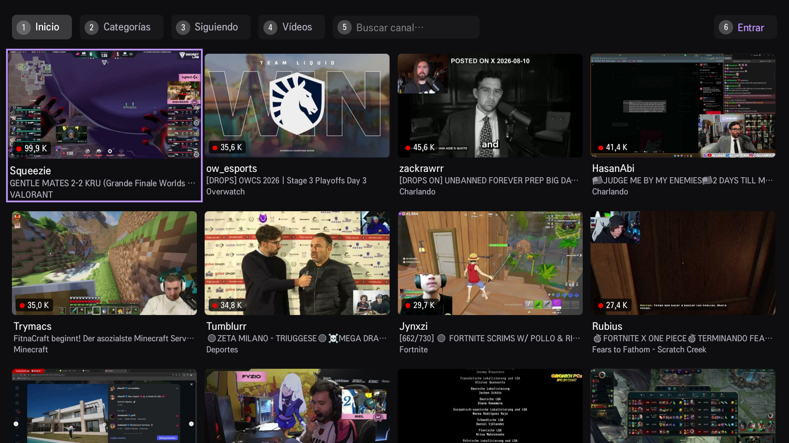

# Twitch Lite for webOS

A lightweight Twitch client for LG webOS TVs. No frameworks: a single `index.html` of about 100 KB, native `<video>` for HLS (with an optional on-demand hls.js for muted VODs), and a chat built for modest hardware.



> **Unofficial.** Twitch Lite is an independent project. It is not made by, endorsed by or affiliated with Twitch Interactive, Inc.

## Install

1. Download `com.twitchlite.app_1.0.0_all.ipk` from the [latest release](https://github.com/adamff-dev/twitch-lite-webos/releases/latest).
2. On your TV, install the **Developer Mode** app from the LG Content Store and turn Developer Mode on.
3. Install the [webOS TV CLI (ares)](https://webostv.developer.lge.com/develop/tools/cli-installation) and connect to your TV:

```sh
ares-setup-device                                              # add the TV once (IP, passphrase from Developer Mode)
ares-install -d <tv> com.twitchlite.app_1.0.0_all.ipk
ares-launch  -d <tv> com.twitchlite.app
```

To build from source instead: `npm install && npm run package`, which creates `out/com.twitchlite.app_1.0.0_all.ipk`.

## Login with Twitch (QR)

The app uses Twitch's *Device Code Grant*: the TV shows a QR code and a short code, you scan the QR with your phone, sign in, and the TV is linked. The only permission requested is `user:read:follows`.

By default it signs in with the **Client ID of the Twitch TV app** (`app/js/config.js`). That is the only client whose token also works with the private GraphQL API that the automatic channel points need. This is why the Twitch authorization page shows the official Twitch TV app as the requesting application.

> **Warning:** using the official client and the private API is not allowed by Twitch's terms and may stop working at any time or affect your account. It is your decision.

Official alternative: register your own app at https://dev.twitch.tv/console (**Client Type: Public**, redirect `http://localhost`) and build with `TWITCH_CLIENT_ID=your_id npm run package`. Everything works the same **except the automatic channel points**.

Without signing in you can use Home, Categories and Search. Following and Videos require signing in.

## Automatic channel points

While you watch a live stream with an active session, the app checks every 60 seconds for a bonus chest and claims it automatically. A banner appears in the player (`+50 points · 1,234`). To turn this off, set `localStorage.setItem('ptsOff', '1')` in the app's storage.

## Muted VOD segments and sub-only VODs

Two workarounds are included for VODs. They bypass Twitch restrictions, may stop working at any time and may violate Twitch's terms. Use them at your own risk.

- **Muted VOD segments.** When a VOD is detected as muted, the player loads `js/hls.light.min.js` (hls.js 0.14.17, about 170 KB) only for that video and plays it through MSE. The media playlist is rewritten so segment URLs point to the original, unmuted files; if an original is no longer available (403/404), it falls back to the muted segment. If hls.js cannot start, the native player is used and the VOD stays muted. Twitch usually keeps the original segments for about 24 hours, sometimes less. You can turn this off in **Settings > Restore muted audio**.
- **Sub-only VODs.** If the playback token is missing or usher returns 403, the app reads the public `video` GraphQL data (`broadcastType`, `createdAt`, `seekPreviewsURL`, `owner.login`), rebuilds the CDN media playlists for the qualities that exist and plays the first one. The quality menu still lists the qualities found. This only works while those CDN files are public.

hls.js is shipped separately in `app/js/hls.light.min.js`; the build copies it to `dist/js/` instead of inlining it, so the app still loads a single file at startup and only fetches hls.js when a muted VOD needs it. hls.js is © its authors, licensed under [Apache-2.0](https://github.com/video-dev/hls.js/blob/master/LICENSE).

## Language

The interface is available in **English** and **Spanish**. It follows the TV's system language (Spanish if it starts with `es`, English otherwise). There is no language switch: if you change the TV language while the app is open, the interface updates by itself.

**Content from your country.** Home, and the live streams of a category, show channels that broadcast in your system language (for example Spanish for `es-ES`, Portuguese for `pt-BR`). It uses Twitch's broadcaster-language filter, which works on the language the streamer sets, not on their country. If nobody is live in that language, Home shows everything. The category list is not filtered, because Twitch does not offer that filter for categories. Languages Twitch has no filter for (for example Hebrew) show everything. To turn the filter off, see **Settings > Content from my country > Everything**.

Translations live in `app/js/i18n.js`. To add a language, copy the `en` block and translate it.

## Screens

| Tab | Content |
|---|---|
| Home | Most-watched live streams in your language (see [Content from your country](#language)) |
| Categories | Categories, then their live streams (filtered by your language) |
| Following | Live streams from the channels you follow (requires sign-in) |
| Videos | Your followed channels, then their past broadcasts (VODs). A channel that is live appears first |
| Search | Channels (live ones first), then their videos |
| Sign in / account | QR sign-in, or sign out |

## Remote control

**Navigation**

| Key | Action |
|---|---|
| Arrows / OK | Move / open. Pressing Down from the tabs returns to the last card |
| Back | Previous view → tabs → Home → a hint; press Back again to close the app |
| 1 – 6 | Home, Categories, Following, Videos, Search, Account (Sign in / your user) |
| CH+ / CH− (or Page Up / Page Down) | Jump 3 rows |
| Yellow | On a live stream: show that channel's videos |
| Red | Refresh the current tab |
| Green | Settings (also inside the player, so you can watch the chat while you change them) |

**Player**

All controls are buttons in the bottom panel. The panel hides itself after a few seconds (4 s by default) and stays visible while paused.
The buttons are **◀ 10 s · Pause/Play · 10 s ▶** (VOD only), **Quality**, **Chat** and **Exit**.

| Key | Action |
|---|---|
| ◀ ▶ | Move focus between the buttons. With the panel hidden, it only shows the panel |
| ▲ ▼ | On a VOD, move between the buttons and the progress bar |
| OK | Press the focused button. With the panel hidden, pauses or resumes |
| ◀ ▶ on the progress bar (VOD) | Skip ±10 s. **Press repeatedly to skip further**: 10, 10, 30, 30, 60, 60, 120, 120, 300 s. One seek is applied when you stop pressing |
| Back | Closes the quality menu; otherwise exits the player |
| Play / Pause / Stop / ⏪ ⏩ | Media keys keep working (⏪ ⏩ skip at least 30 s) |

The Magic Remote pointer works too: moving it shows the panel, and you can click buttons and qualities.
On a live stream, resuming after a pause of more than 2 s jumps to the live edge (after 30 s or more the stream is reloaded). 

**Resuming VODs.** A VOD continues where you left it (not if you finished it or watched under 15 s). The position is stored on the TV; when you are signed in with the default Twitch TV client it is also read from Twitch (`video.self.viewingHistory`), so a VOD you left on your phone or PC resumes on the TV, and the most recent position wins. Twitch exposes no public operation to *write* that position, so what you watch on the TV stays on the TV.

**Ads.** During an ad on a live stream (detected from the HLS playlist: `stitched-ad` date ranges or ad-titled segments) the audio is muted and restored when the ad ends. The ad itself still plays: nothing is skipped or blocked.

## Settings

Press **Green** to open the settings. ▲ ▼ move between rows, ◀ ▶ change the value, OK goes to the next value, and Back or Green closes it. Changes apply immediately and are saved on the TV:

- **Tab on app start**: Home, Categories, Following or Videos.
- **Content from my country**: *Automatic* (the default: Home and category streams use your system language, see [Language](#language)) or *Everything*. Changing it reloads Home and Categories.
- **Restore muted audio**: *Yes* (the default) or *No*. See [Muted VOD segments and sub-only VODs](#muted-vod-segments-and-sub-only-vods).
- **Chat**:
  - text size (4 levels);
  - width (5–100 % of the screen, in steps of 5);
  - height (5–100 % of the screen, in steps of 5; 100 % by default). The chat stays anchored to the top or bottom edge, depending on the position;
  - position (top or bottom, left or right);
  - background opacity (0–100 %; the text has a shadow so it stays readable on a transparent background).
- **Hide the player panel after**: 3, 4, 6, 10 or 15 s.
- **Credits**: the author, the project link and a QR code for donations. OK opens the screen and OK or Back returns to the settings. The donation link is `CONFIG.CREDITS.donate` in `app/js/config.js`; while it is empty, the QR points to the project page.
- **Restore default values**.

## Chat (read-only)

On a **live stream** it shows the live chat. On a **VOD** it shows the replay of the original chat, synchronized with the video: messages appear when the video reaches their second, and a seek (forward, backward or a quality change) reloads the chat from the new position. Nothing appears while paused.

Turn it on with Down during a live stream. The preference is remembered. It is designed for modest TVs:

- a single WebSocket connection, **open only while the chat is visible**;
- **30 fixed DOM nodes that are recycled** (no elements are created or destroyed at runtime);
- at most **4 repaints per second** and 8 messages per repaint: during bursts, older messages are dropped;
- no images (emotes appear as text), messages up to 160 characters, and an overlay panel (the video is not resized);
- disconnects when you leave the stream or when the app goes to the background.

## Development

```sh
npm test            # Chromium 53 compatibility + mocked network + UI flows in jsdom
npm run package     # builds dist/ and the .ipk in out/ (optional: TWITCH_CLIENT_ID=xxx)
ares-inspect -d <tv> com.twitchlite.app --open   # remote DevTools
```

Desktop testing: open `app/index.html` in Chrome (arrow keys, Enter, Esc/Backspace = Back).

The app targets webOS 4 and later (Chromium 53), so the code avoids `async/await`, spread, optional chaining and CSS grid. `npm test` checks this.

## Structure

- `app/js/api.js`: Twitch GraphQL (no sign-in needed), access token and HLS master playlist
- `app/js/auth.js`: Device Code Grant, token refresh, Helix (followed channels)
- `app/js/points.js`: automatic channel points claim (private GraphQL, needs the TV client)
- `app/js/qr.js`: our own QR generator (checked with OpenCV, see `tools/qr-check`)
- `app/js/chat.js`: optimized read-only chat (live IRC, and the synchronized replay for VODs)
- `app/js/ads.js`: detects ads in the live playlist (the player mutes the audio during them)
- `app/js/resume.js`: VOD resume position (local and, when available, from Twitch)
- `app/js/unmute.js`: restores the audio of muted VOD segments (loads `hls.light.min.js` on demand)
- `app/js/settings.js`: settings (Green button)
- `app/js/credits.js`: credits screen (Settings > Credits), with the donation QR from `CONFIG.CREDITS` in `app/js/config.js`
- `app/js/login.js`, `player.js`, `app.js`: sign-in screen, player, views and remote control
- `app/js/i18n.js`: translations (English and Spanish)
- `tools/build.mjs`: inlines CSS and JS, minifies lightly and generates the icons

## License

[MIT](LICENSE). The bundled hls.js is licensed under Apache-2.0.
